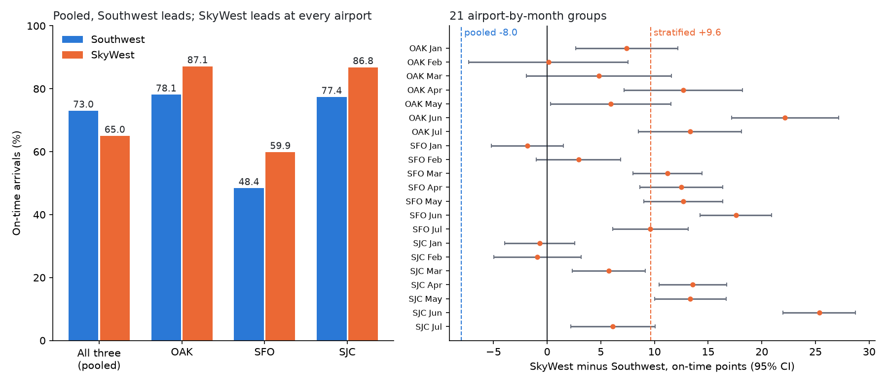
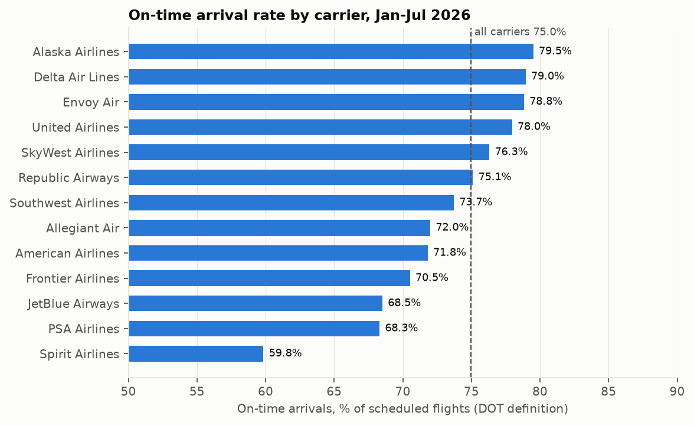
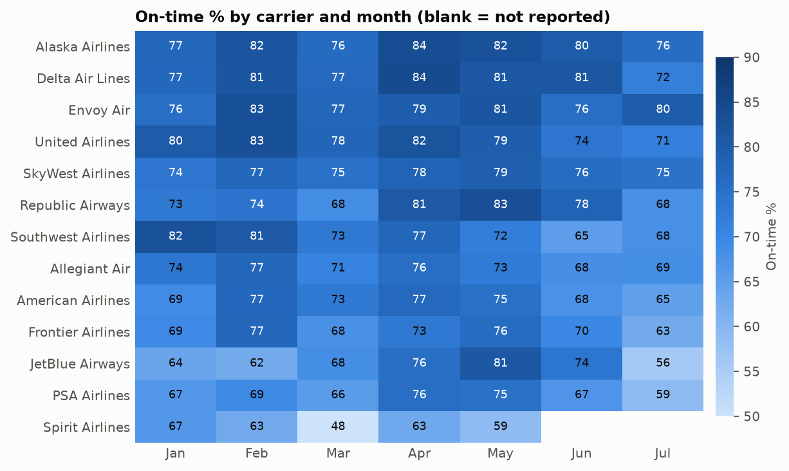
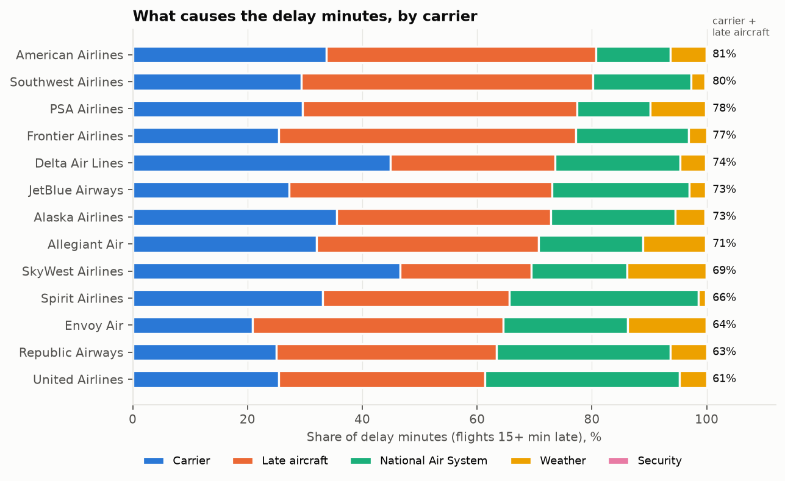
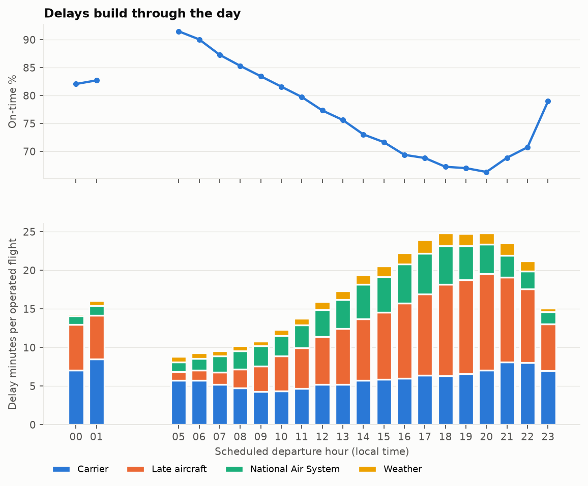
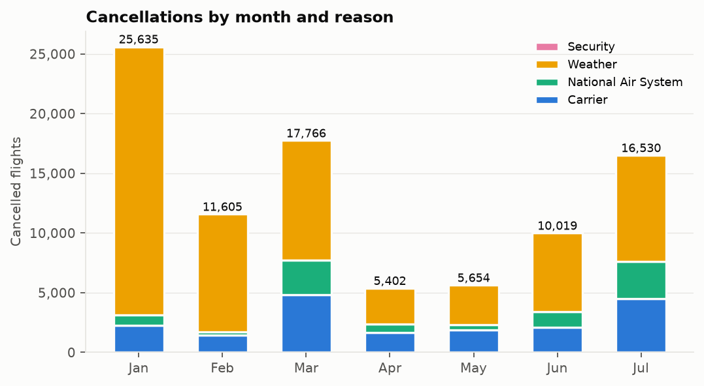
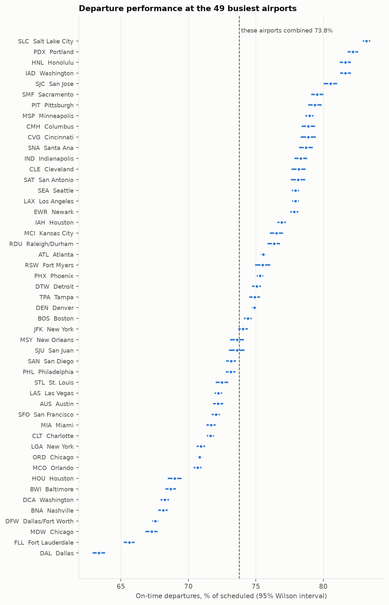
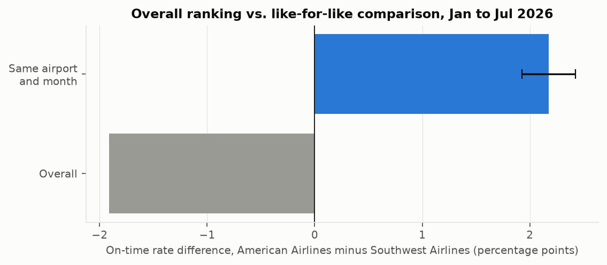

# Automated reporting pipeline: 4.1M U.S. flight records

A reproducible ETL pipeline in Python, SQL and SQLite. It loads seven monthly Bureau of
Transportation Statistics (BTS) on-time files, January to July 2026, into SQLite. It then runs
12 data-quality checks, reproduces every on-time figure DOT published for those months, and
tests the Southwest and SkyWest comparison into the Bay Area for a Simpson's paradox.

One command runs everything and writes a dated report. A rerun on unchanged files only checks
them, and a new or revised month is picked up automatically. A blocking data problem stops the run
with a non-zero exit code, so a scheduler or CI job can alert on it.

```
python -m flightpipe run
```

## Results from the current run

| Measure | Result |
|---|---|
| Records loaded | **4,120,342** flights from 7 files (1 exact duplicate skipped) |
| Data-quality checks | **All 12 ran; 0 stopped the run.** One check flagged 105 BTS source flights for review (see below) |
| Published DOT figures reproduced | **96 of 96** within the ±0.05-point rounding band (89 carrier-months and 7 monthly totals); largest difference 0.050 |
| Bay Area, pooled | Southwest **73.0%** on time vs SkyWest **65.0%** (gap −8.0 points, 95% CI −9.6 to −6.5) |
| Bay Area, same airport and month | SkyWest ahead by **+9.6 points** (95% CI +8.2 to +11.0) across 21 airport-by-month groups |

Full detail: [`outputs/run_report.md`](outputs/run_report.md).



## The Simpson's paradox

Pooled across Oakland (OAK), San Francisco (SFO) and San José (SJC), Southwest arrives on time
more often than SkyWest, and leads in 6 of 7 months. Compare them at the same airport, though,
and SkyWest leads at all three:

| Airport | SkyWest | Southwest | Share of SkyWest flights | Share of Southwest flights |
|---|---:|---:|---:|---:|
| OAK | 87.1% | 78.1% | 4% | 43% |
| SFO | 59.9% | 48.4% | 81% | 16% |
| SJC | 86.8% | 77.4% | 15% | 41% |

The reversal comes from where each airline flies. About four in five SkyWest arrivals land at
SFO, which is much the hardest airport of the three, while most Southwest arrivals land at OAK and
SJC. Pooling therefore compares SkyWest's SFO-heavy schedule with Southwest's easier one.

For a traveller whose destination airport is fixed, the like-for-like figure is the one that
matters. Holding airport and month fixed, SkyWest is ahead in 18 of 21 airport-by-month groups,
significantly in 15. Southwest is not significantly ahead in any of them: its three leads (SFO in
January, SJC in January and February) are within 2 points, and their intervals cross zero.

**Method.** Each stratum is one destination airport in one month. Differences are combined with
Mantel-Haenszel weights, n<sub>SkyWest</sub>·n<sub>Southwest</sub> / (n<sub>SkyWest</sub> + n<sub>Southwest</sub>).
Two kinds of 95% interval are given:
- **Wald:** treats flights as independent.
- **Cluster bootstrap:** resamples whole days, 2,000 times. Flights on the same day share weather
  and air-traffic delays, so this interval is wider and more honest.

## Operational insights, all carriers

The pipeline also answers four operational questions for all 13 carriers. These charts and
tables are regenerated on every run, from the SQL in [`sql/`](sql/).



**1. On-time rank and disruption risk are different things.** Alaska (79.5%) and Delta (79.0%)
lead on on-time arrivals, and Spirit trails at 59.8%. Southwest is 7th of 13 on on-time rate
(73.7%), but it has the second-lowest rate of 3-hour-plus delays: 78 per 10,000 operated flights,
against 320 for PSA and 251 for American. A traveller worried about missing a connection should
look at both measures. → [`carrier_scorecard.csv`](outputs/tables/carrier_scorecard.csv)



**2. Most delay minutes are attributed to the airline, not the weather.** For every carrier,
carrier-caused plus late-arriving-aircraft minutes make up 61–81% of all delay minutes, and
weather is under 14%. Late-arriving aircraft is the largest single cause for 10 of the 13 carriers
(51% of Southwest's delay minutes and 52% of Frontier's). SkyWest and Delta lose the most to
carrier-caused delays (47% and 45%).



**3. Delays cascade through the day.** Flights scheduled to leave at 5 a.m. arrive on time 91.5%
of the time; by 8 p.m. that falls to 66.3%. Most of the growth is late-arriving aircraft, 1.2
minutes per flight at 5 a.m. against 12.5 minutes at 8 p.m., as delays from earlier legs are
passed down the aircraft's rotation.



**4. Weather drives cancellations, and winter hits hardest.** 69% of the 92,611 cancellations were
weather-related. January alone had 25,635 cancellations, 88% of them for weather.



**5. Airport performance varies by 20 points.** Among the 49 airports with 20,000 or more
departures, Salt Lake City leads (83.2% on-time departures) and Dallas Love Field trails (63.4%).
Each airport has between 20,000 and 213,000 departures, so the 95% intervals are under ±0.6
points and the ranking is not noise.



**6. Carrier rankings can also reverse.** The same Simpson's-paradox test, applied to every pair of
carriers at the same origin airport and month, finds 8 of 78 pairs reversing. Only 3 cover at least
half of both carriers' flights, so those are the ones to trust:

| Pair | Overall difference | Same airport and month (95% CI) |
|---|---:|---:|
| American minus Southwest | −1.9 points | +2.2 points (+1.9 to +2.4) |
| Alaska minus United | +1.5 points | −0.7 points (−1.2 to −0.3) |
| Alaska minus Delta | +0.6 points | −0.9 points (−1.6 to −0.1) |

American trails Southwest overall (71.8% vs 73.7%), but the flight-weighted comparison at shared
airport-months favours American by 2.2 points. American wins only 305 of the 597 compared cells,
so the reversal comes from large airport-months, not from American winning most places. For
this test, cells need at least 50 flights per carrier, and each cell is weighted by the two
carriers' combined flights. → [`simpsons_paradox_pairs.csv`](outputs/tables/simpsons_paradox_pairs.csv)



[`bi_extract_month_carrier_airport.csv`](outputs/tables/bi_extract_month_carrier_airport.csv) has
one row per month, carrier and origin airport (10,179 rows), ready for a Tableau or Power BI
dashboard.

## What the pipeline does

```
monthly BTS CSVs ─► load ─────────────► check ───────────► reconcile ───────────► analyze ─────────► report
(any file names)    SHA-256 manifest,   12 checks,         parse DOT Table 1A/1B   21 airport-month   run_report.md,
                    skip unchanged,     stop on blocking   from the ATCR PDFs,     strata, MH and     runs/<id>.json,
                    replace revised,    problems, list     compare 96 figures      bootstrap CIs      logs/<id>.log
                                        flagged rows
                    drop duplicates
```

| Stage | Module | What it does |
|---|---|---|
| Load | `flightpipe/load.py` | Finds every CSV with BTS flight columns, fingerprints it with SHA-256, and streams it in 250,000-row chunks into an indexed `flights` table. A row hash under a unique index means a duplicate row is never stored twice. Unchanged files are skipped, and a changed file has its old rows replaced, because BTS revises months. Lookup tables are loaded too. |
| Check | `flightpipe/quality.py` | 12 checks (below). Results go in the `dq_results` table on every run. |
| Reconcile | `flightpipe/reference.py`, `reconcile.py` | Extracts DOT's published rates from the Air Travel Consumer Report PDFs, recomputes each one from the flights, and records the difference. |
| Analyze | `flightpipe/paradox.py` | Builds the Bay Area summary table, the 21 strata, the stratified estimate with both intervals, and the chart. |
| Insights | `flightpipe/insights.py`, `sql/*.sql` | Runs the SQL queries for the six operational charts and the carrier-pair test, and writes `outputs/figures/` and `outputs/tables/`. |
| Report | `flightpipe/report.py` | Writes `outputs/run_report.md` and a JSON record of the run. |

### The 12 checks

| Check | Rule | If it finds a problem | Current run |
|---|---|---|---|
| DQ-01 | Every monthly file has the 23 columns the pipeline needs | stops the run | pass |
| DQ-02 | Every row the manifest says was inserted is in the table | stops the run | pass |
| DQ-03 | Each file holds exactly one month of the configured year | stops the run | pass |
| DQ-04 | Date, carrier, origin, destination, schedule and status are never blank | stops the run | pass |
| DQ-05 | Carrier codes exist in the BTS carrier lookup | stops the run | pass |
| DQ-06 | Airport codes exist in the BTS airport lookup | stops the run | pass |
| DQ-07 | Cancelled flights have a valid reason code, and other flights have none | stops the run | pass |
| DQ-08 | Cancelled flights have no arrival time or delay | stops the run | pass |
| DQ-09 | Operated flights have an arrival delay | stops the run | pass |
| DQ-10 | The 15-minute flag agrees with the arrival delay | stops the run | pass |
| DQ-11 | Scheduled times are valid hhmm clock times | stops the run | pass |
| DQ-12 | Delay-cause minutes add up to the arrival delay | lists the rows; run continues | 105 flights flagged |

**What DQ-12 found.** Of 926,183 operated flights that arrived 15 or more minutes late, 105
(0.01%) have no delay cause recorded. In 104 of them, all Southwest flights from March to July,
the airline reported the delay but put 0 minutes against all five causes. The other is a
Frontier flight with the cause fields blank. BTS's own files show the same: its separately
published June file, and its current online July file, checked November 2026.

This is a gap in the source data, not a loading error, so the pipeline doesn't invent causes.
The flights are valid for on-time reporting and stay in the data, and each one is listed in
[`outputs/dq_exceptions.csv`](outputs/dq_exceptions.csv) for follow-up. `--strict` makes a flagged
check stop the run.

### Where the 96 published figures come from

- **91 are read from the PDFs automatically.** For February to July this is Table 1A of each
  report. For nine January figures it is Table 1B of the September report, which repeats every
  month of the year and gives each airline's own flights on a separate row.
- **5 are typed in.** January's figures for Envoy, PSA, Republic, SkyWest and the all-carrier
  total appear only in the March 2026 report, which isn't in `reference/atcr/`. They are in
  `reference/manual_reference.csv` with their source. To remove them, add the March 2026 report
  to `reference/atcr/`, and the pipeline will read Table 1A instead.

**Definition.** On time follows DOT: a flight is on time if it operated and arrived less than 15
minutes late. Cancelled and diverted flights count as not on time and stay in the denominator.
This is why SkyWest's Bay Area count is 22,481 flights and Southwest's is 36,727.

## Run it

1. **Install:** run `pip install -r requirements.txt` with Python 3.11 or later.
2. **Add the data:** put the monthly BTS files and the `L_*.csv` lookups in the folder named by
   `raw_dir` in `pipeline.toml`, or set the `FLIGHTPIPE_RAW_DIR` environment variable. The files
   come from the BTS [Reporting Carrier On-Time Performance](https://www.transtats.bts.gov/DL_SelectFields.aspx?gnoyr_VQ=FGJ&QO_fu146_anzr=b0-gvzr)
   download, with all fields and one file per month. File names don't matter.
3. **Run:**

| Command | What it does |
|---|---|
| `python -m flightpipe run` | Every stage. About 7 minutes the first time, about 75 seconds when nothing has changed |
| `python -m flightpipe check` | Load new files and run the checks only |
| `python -m flightpipe run --full-refresh` | Rebuild the database from scratch |
| `python -m flightpipe run --strict` | Also stop the run if a check flags rows |
| `python -m pytest` | Run the 10 tests, which use synthetic data and need no download |

**Exit codes:** `0` success, `2` a data-quality check failed, `3` a published figure was not
reproduced, `1` any other error.

**Scheduling.** To run monthly on Windows, use `run_pipeline.ps1` with Task Scheduler:

```
schtasks /Create /TN "flight-reporting" /SC MONTHLY /D 20 /ST 07:00 /TR "powershell -File C:\path\to\run_pipeline.ps1"
```

On Linux or macOS, use cron with `python -m flightpipe run`. GitHub Actions runs the tests on
every push (`.github/workflows/ci.yml`).

## Repository layout

```
├── pipeline.toml        paths, carriers, tolerance, analysis settings
├── flightpipe/          load · quality · reference · reconcile · paradox · insights · report · __main__ (CLI)
├── sql/                 views and the seven insight queries (SQLite)
├── reference/
│   ├── atcr/            DOT Air Travel Consumer Report PDFs (April to September 2026 issues)
│   └── manual_reference.csv   the 5 January figures typed in from the March 2026 report
├── tests/               pytest suite on synthetic data
├── outputs/             run_report.md, Bay Area tables, paradox.png, runs/*.json
│   ├── figures/         the seven operational charts (01-07)
│   └── tables/          their tables and the BI extract
├── data/flights.db      SQLite database (git-ignored)
└── logs/                one log file per run (git-ignored)
```

## Limits

- **Reporting carriers only:** the data covers carriers with at least 0.5% of domestic
  scheduled passenger revenue, not every U.S. flight.
- **Airport and month only:** the stratified estimate controls for destination airport and month.
  Route, time of day and origin are not controlled.
- **Its weights are not a traveller's:** the Mantel-Haenszel weights reflect where both airlines
  fly. For a specific traveller, weight the airport rows in `outputs/paradox_by_airport.csv` by
  how often they actually fly to each airport.
- **January's 5 typed-in figures** are checked against the data like the rest, but they were not
  read from a PDF on file.
- **Late aircraft is not always the airline's fault:** a late-arriving aircraft can have been
  delayed by weather or air-traffic control on an earlier leg. Carrier plus late aircraft is
  therefore an upper bound on delay within an airline's control.
- **The carrier-pair test** credits each flight to its origin airport, controls only for airport
  and month, and treats flights as independent, so its intervals are somewhat optimistic.
- **Spirit Airlines** has no reported flights for June and July 2026.

## Data and licence

U.S. Department of Transportation: BTS *Airline On-Time Performance Data*, and the Office of
Aviation Consumer Protection's *Air Travel Consumer Report* (April to September 2026 issues).
Both are U.S. government works in the public domain.
