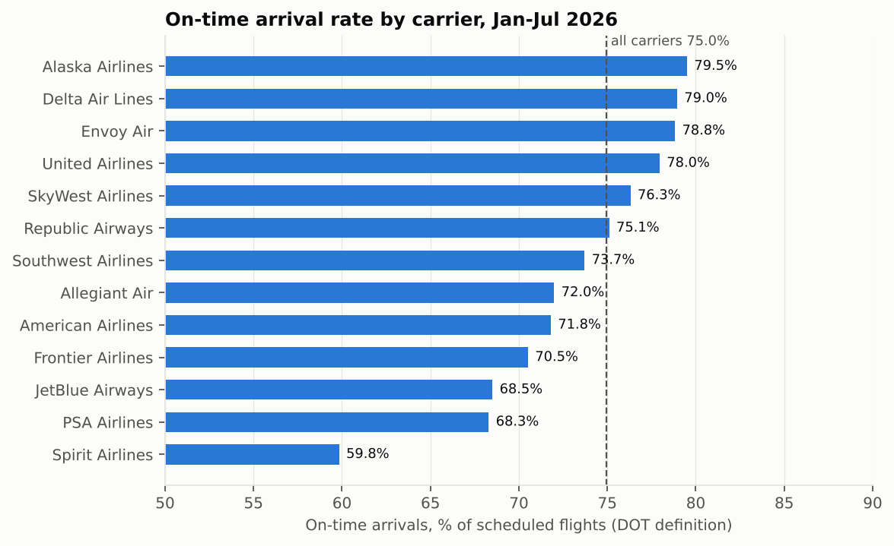
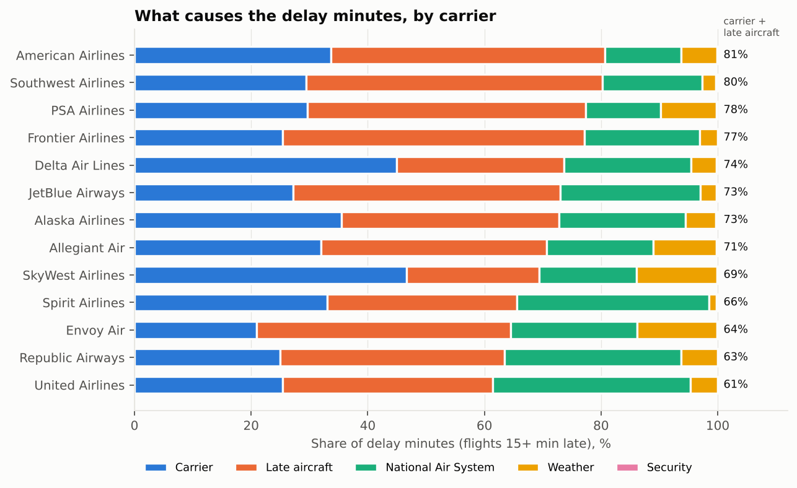
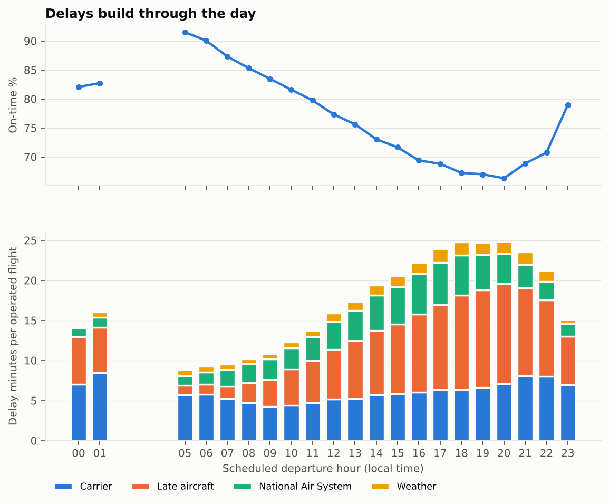

# U.S. Flight Delay Pipeline — 4.1M flights, Jan–Jul 2026

An end-to-end Python + SQL pipeline that loads seven months of U.S. DOT Bureau of
Transportation Statistics (BTS) on-time data (**4,120,342 domestic flights, 13
carriers, 357 airports**) into SQLite, validates the results against DOT's own
published figures, and answers four operational questions:

1. Which carriers are most reliable, and does on-time rank tell the whole story?
2. What actually causes delay minutes, and how much is within an airline's control?
3. How do delays build up through the day?
4. Which airports and months drive cancellations and late departures?



## Pipeline

```
data/raw/*.csv  ──►  ingest.py  ──►  data/flights.db (SQLite)  ──►  validate.py  ──►  analyze.py
 7 BTS files         chunked load,        indexed `flights`           checks vs DOT       sql/*.sql →
 (54 columns)        type casting,        table + lookups             Air Travel          tables (CSV)
                     de-duplication,                                  Consumer Report     + figures (PNG)
                     derived fields,
                     quality checks  ─────────────────────────────►  outputs/data_quality_report.md
```

| Step | File | What it does |
|---|---|---|
| Ingest | `src/ingest.py` | Streams each monthly CSV in 250k-row chunks, keeps 27 of 54 fields, drops exact duplicate rows across files, adds derived fields (DOT on-time flag, operated flag, scheduled departure hour, 3h+ severe-delay flag), loads SQLite and builds indexes. Runs 12 data-quality checks. |
| Validate | `src/validate.py` | Recomputes on-time % for every carrier and month and compares it with Table 1A of the DOT Air Travel Consumer Report (`reference/atcr_table1a_ontime.csv`). |
| Analyse | `src/analyze.py`, `sql/*.sql` | Seven SQL queries produce the analysis tables; Python adds Wilson confidence intervals and draws the charts. |
| BI extract | `sql/07_tableau_extract.sql` | A compact month × carrier × airport table (10k rows) for building a Tableau or Power BI dashboard on top. |

### Definitions

- **On-time arrival (DOT definition):** the flight operated and arrived less than 15
  minutes after schedule. Cancelled and diverted flights stay in the denominator
  and count as *not* on time. This is the definition DOT uses in its monthly
  Air Travel Consumer Report.
- **On-time departure:** not cancelled and departed less than 15 minutes late.
- **Severe delay:** an operated flight arriving 180+ minutes late.
- **Delay causes:** BTS splits each arrival delay of 15+ minutes into carrier,
  late-arriving aircraft, National Air System (NAS), weather and security minutes.

## Validation

**96 of 96** published DOT on-time figures (89 carrier-months and 7 monthly
all-carrier totals) are reproduced to within DOT's ±0.05-point rounding band. The
largest difference is 0.050 points. See `outputs/tables/validation_vs_dot_atcr.csv`
and `outputs/data_quality_report.md`.

Data-quality findings from the load:
- One exact duplicate row (May file) removed.
- 92,611 cancellations: every one has a reason code and no arrival delay recorded.
- 105 delayed flights whose five cause fields do not sum to the arrival delay —
  flagged in the report and kept, because the arrival delay itself is valid.

## Key findings

**1. On-time rank and disruption risk are different things.** Alaska (79.5%) and
Delta (79.0%) lead on on-time arrivals; Spirit trails at 59.8%. But Southwest,
7th of 13 on on-time rate (73.7%), has the second-lowest rate of 3-hour-plus
delays (78 per 10,000 operated flights, vs 320 for PSA and 251 for American).
A traveller who cares about missing a connection should look at both measures.
→ `outputs/tables/carrier_scorecard.csv`

**2. Most delay minutes are attributed to the airline, not the weather.** For
every carrier, carrier-caused plus late-arriving-aircraft minutes make up 61–81%
of all delay minutes. Weather is under 14% for every carrier. Late-arriving
aircraft is the single largest cause for most carriers (51% of Southwest's and
52% of Frontier's delay minutes), while SkyWest and Delta lose the most to
carrier-caused delays (47% and 45%).



**3. Delays cascade through the day.** Flights scheduled to leave at 5 a.m. arrive
on time 91.5% of the time; by 8 p.m. that falls to 66.3%. The growth is mostly
late-arriving aircraft: 1.2 minutes per flight at 5 a.m. vs 12.5 minutes at
8 p.m., as delays from earlier legs are passed down the rotation.



**4. Weather drives cancellations, and winter hits hardest.** 69% of the
92,611 cancellations were weather-related. January alone had 25,635
cancellations, 88% of them for weather.

**5. Airport performance varies by 20 points.** Among the 49 airports with
20,000+ departures, Salt Lake City leads (83.2% on-time departures) and Dallas
Love Field trails (63.4%). With 20,000–213,000 departures per airport, the 95%
intervals are under ±0.6 points, so the ranking is not noise.

More figures: `outputs/figures/02_on_time_heatmap.png` (carrier × month),
`05_airports.png`, `06_cancellations.png`.

## How to run it

1. **Get the data.** From BTS TranStats,
   [Reporting Carrier On-Time Performance (1987–present)](https://www.transtats.bts.gov/DL_SelectFields.aspx?gnoyr_VQ=FGJ&QO_fu146_anzr=b0-gvzr),
   download January–July 2026 with all fields, one file per month. Put the CSVs
   (any names) in `data/raw/`. The raw files (~1.2 GB) are not committed.
2. **Install:** `pip install -r requirements.txt` (Python 3.10+).
3. **Run:** `python src/run_pipeline.py`. A full run takes about 3 minutes;
   `python src/run_pipeline.py --skip-ingest` reruns validation and analysis on the
   existing database in under a minute.

## Repository layout

```
├── src/            config.py · ingest.py · validate.py · analyze.py · run_pipeline.py
├── sql/            01–07 analysis queries (SQLite)
├── reference/      atcr_table1a_ontime.csv  (published DOT figures used for validation)
├── outputs/
│   ├── tables/     analysis tables, validation results, BI extract
│   ├── figures/    six charts
│   └── data_quality_report.md
└── data/raw/       place BTS CSVs here (git-ignored)
```

## Data source and licence

U.S. Department of Transportation, Bureau of Transportation Statistics, *Airline
On-Time Performance Data*, and Office of Aviation Consumer Protection, *Air Travel
Consumer Report* (March–September 2026 issues). U.S. government works, public
domain.

## Limitations

- Covers reporting carriers only (those with at least 0.5% of domestic scheduled
  passenger revenue), so it is not every U.S. flight.
- "Late aircraft" delay can originate from weather or air-traffic control on an
  earlier leg, so the carrier + late-aircraft share is an upper bound on delay that
  is strictly within the airline's control.
- Spirit Airlines has no reported flights for June–July 2026 in the data.
