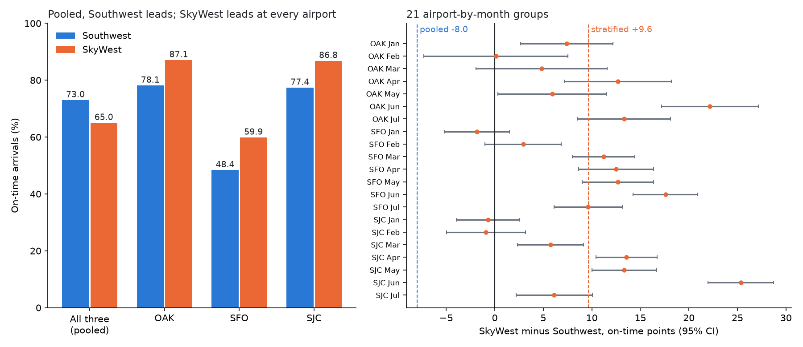

# Run report: 20261107T191628Z

Status: **success**. Started 2026-11-07 19:16 UTC, 93 seconds.

## 1. Load

4,120,342 flight records in `flights.db` from 7 monthly files.

| File | Period | Rows inserted | Duplicates skipped | This run |
|---|---|---:|---:|---|
| T_ONTIME_REPORTING_Jan.csv | 2026-01 | 544,003 | 0 | skipped |
| T_ONTIME_REPORTING_Feb.csv | 2026-02 | 515,037 | 0 | skipped |
| T_ONTIME_REPORTING_Mar.csv | 2026-03 | 612,102 | 0 | skipped |
| T_ONTIME_REPORTING_Apr.csv | 2026-04 | 597,919 | 0 | skipped |
| T_ONTIME_REPORTING_May.csv | 2026-05 | 611,734 | 1 | skipped |
| T_ONTIME_REPORTING_Jun.csv | 2026-06 | 607,577 | 0 | skipped |
| T_ONTIME_REPORTING_Jul.csv | 2026-07 | 631,970 | 0 | skipped |

## 2. Data-quality checks

All 12 checks ran: 11 found no problems, 0 stopped the run and 1 flagged rows for review.

DQ-12 flagged 105 flights: 104 where every cause was reported as 0 minutes; 1 where no causes were reported (carriers: WN 104, F9 1). These come from the BTS source files. The flights are valid for on-time reporting, so they are kept, and each one is listed in `dq_exceptions.csv`.

| Check | What it tests | If it finds a problem | Result |
|---|---|---|---|
| DQ-01 | Every monthly file has the columns the pipeline needs | stops the run | pass |
| DQ-02 | Every row the manifest says was inserted is in the table | stops the run | pass |
| DQ-03 | Each file holds exactly one month of 2026 | stops the run | pass |
| DQ-04 | Key fields are never blank (date, carrier, origin, destination, schedule, status) | stops the run | pass |
| DQ-05 | Carrier codes exist in the BTS carrier lookup | stops the run | pass |
| DQ-06 | Origin and destination codes exist in the BTS airport lookup | stops the run | pass |
| DQ-07 | Cancelled flights have a valid reason code, and other flights have none | stops the run | pass |
| DQ-08 | Cancelled flights have no arrival time or arrival delay | stops the run | pass |
| DQ-09 | Operated flights have an arrival delay | stops the run | pass |
| DQ-10 | The 15-minute flag agrees with the arrival delay | stops the run | pass |
| DQ-11 | Scheduled times are valid hhmm clock times | stops the run | pass |
| DQ-12 | Delay-cause minutes add up to the arrival delay (flights 15+ min late) | lists the rows; run continues | 105 rows flagged |

## 3. Reconciliation with DOT's published figures

**96 of 96** published on-time rates reproduced within +/-0.05 points (89 carrier-months and 7 monthly all-carrier totals). 91 published figures were extracted from the ATCR PDFs automatically; 5 were typed in from a report not on file (`reference/manual_reference.csv`).

Largest differences:

| Month | Carrier | Published | Computed | Difference | Source |
|---:|---|---:|---:|---:|---|
| 3 | ALASKA AIRLINES | 76.4 | 76.350 | -0.050 | Table 1A |
| 7 | REPUBLIC AIRWAYS | 68.1 | 68.051 | -0.049 | Table 1A |
| 7 | ALLEGIANT AIR | 68.6 | 68.552 | -0.048 | Table 1A |
| 1 | SKYWEST AIRLINES | 74.0 | 74.048 | +0.048 | typed in from Table 1A |
| 2 | JETBLUE AIRWAYS | 62.3 | 62.347 | +0.047 | Table 1A |

## 4. Simpson's paradox: SkyWest vs Southwest, arrivals at OAK, SFO, SJC

Pooled across the airports, SkyWest is on time 65.0% of the time (22,481 flights) and Southwest 73.0% (36,727). SkyWest led in 1 of 7 months on the pooled figures.

| Comparison | SkyWest minus Southwest (points) | 95% CI, flights independent | 95% CI, resampling days |
|---|---:|---|---|
| Pooled (crude) | -8.0 | -8.8 to -7.2 | -9.6 to -6.5 |
| Same airport and month (21 groups) | +9.6 | +8.7 to +10.5 | +8.2 to +11.0 |

SkyWest is ahead in 18 of 21 airport-by-month groups (significantly in 15); Southwest is significantly ahead in 0. Paradox detected: **yes**.

Why the pooled figure reverses:

| Airport | SkyWest on time | Southwest on time | Share of SkyWest flights | Share of Southwest flights | Gap, same month |
|---|---:|---:|---:|---:|---|
| OAK | 87.1% | 78.1% | 4% | 43% | +10.6 (+8.4 to +12.8) |
| SFO | 59.9% | 48.4% | 81% | 16% | +9.7 (+8.4 to +11.1) |
| SJC | 86.8% | 77.4% | 15% | 41% | +9.2 (+7.9 to +10.5) |

Strata are destination airport by month; the stratified estimate uses Mantel-Haenszel weights. On time follows DOT: cancelled and diverted flights count as late and stay in the denominator.

## 5. Operational insights

On-time leaders: Alaska Airlines 79.5%, Delta Air Lines 79.0%; lowest: Spirit Airlines 59.8%. Carrier-pair test at the same origin airport and month: 8 of 78 pairs reverse, 3 of them covering at least half of both carriers' flights.

| Figure | Table |
|---|---|
| [`01_carrier_on_time.png`](figures/01_carrier_on_time.png) | [`carrier_scorecard.csv`](tables/carrier_scorecard.csv) |
| [`02_on_time_heatmap.png`](figures/02_on_time_heatmap.png) | [`on_time_by_carrier_month.csv`](tables/on_time_by_carrier_month.csv) |
| [`03_delay_causes.png`](figures/03_delay_causes.png) | [`delay_cause_shares.csv`](tables/delay_cause_shares.csv) |
| [`04_delay_by_hour.png`](figures/04_delay_by_hour.png) | [`delay_by_departure_hour.csv`](tables/delay_by_departure_hour.csv) |
| [`05_airports.png`](figures/05_airports.png) | [`airport_departure_performance.csv`](tables/airport_departure_performance.csv) |
| [`06_cancellations.png`](figures/06_cancellations.png) | [`cancellations_by_reason.csv`](tables/cancellations_by_reason.csv) |
| [`07_simpsons_paradox.png`](figures/07_simpsons_paradox.png) | [`simpsons_paradox_pairs.csv`](tables/simpsons_paradox_pairs.csv) |

## Outputs

- `bay_area_carrier_summary.csv`, `paradox_strata.csv`, `paradox_by_airport.csv`, `paradox_summary.json`, `paradox.png`
- `reconciliation_vs_dot.csv`, `dq_exceptions.csv`
- `runs/<run id>.json`: this run's record
